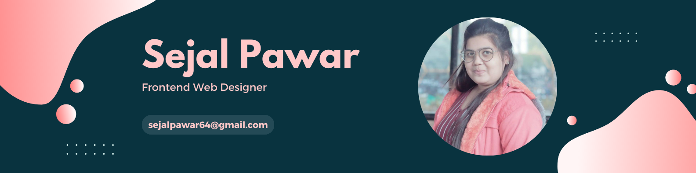

<h1 align="center">Hi 👋, I'm Sejal Pawar</h1>
<h3 align="center">Sr. Frontend Designer & Team Lead · Building fast, pixel-perfect websites since 2021</h3>

  
  

### 👩‍💻 About me

- 🏢 **Sr. Frontend Designer & Team Lead** at **Just Digital Gurus**
- 🎨 I turn designs into clean, responsive, conversion-focused websites
- 🧩 WordPress / Elementor specialist: custom themes, sections and landing pages
- 🤖 Currently building **Concept Studio**, an AI tool that generates homepage redesign concepts for sales pitches
- 👥 Leading a frontend team and shipping client projects end to end
- 📍 Based in Badlapur, India

 

### 🛠 Tech I use daily

  

### 💼 Experience

| Role | Company | Years |
|---|---|---|
| Sr. Frontend Designer & Team Lead | Just Digital Gurus | 2023 – Present |
| Frontend Designer | Elite-Infotech | 2021 – 2023 |

### 📫 Let's work together

Open to freelance projects and collaborations. Reach me at **sejalpawar64@gmail.com**
