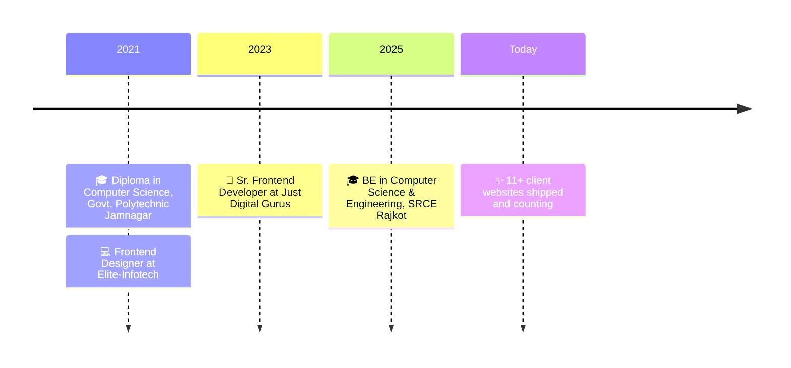

<!-- Header -->
<p align="center">
  
</p>

<p align="center">
  <a href="https://github.com/sejalpawar1012">
    
  </a>
</p>

<p align="center">
  <a href="mailto:sejalpawar64@gmail.com"></a>
  
  
  
</p>

---

<table>
<tr>
<td width="55%" valign="top">

### 👩‍💻 Meet the developer

```javascript
const sejal = {
  role:       "Sr. Frontend Developer",
  company:    "Just Digital Gurus",
  experience: "5+ years",
  superpower: "Figma / PSD → pixel-perfect websites",
  cms:        ["WordPress", "Elementor", "Divi", "Webflow"],
  noCode:     ["Bubble.io", "Wix", "Squarespace", "ClickFunnels"],
  extras:     ["On-page SEO", "Performance", "UI polish"],
  aiStack:    ["Claude", "ChatGPT", "Gemini"],
  languages:  ["English", "Hindi", "Marathi", "Gujarati"],
  available:  true, // for freelance ✨
};
```

</td>
<td width="45%" align="center" valign="middle">
  
</td>
</tr>
</table>

## 🧰 My toolbox

<p align="center">
  
</p>

<p align="center">
      <br/>
      <br/>
    
</p>

## 🛤️ My journey



## 🚀 Websites I've brought to life

<p align="center">
            
</p>

## 💎 What I bring to every project

| 🎯 Pixel-perfect | 📱 Responsive | ⚡ Fast | 🔍 SEO-ready | 🤖 AI-powered workflow |
|:---:|:---:|:---:|:---:|:---:|
| Designs matched to the pixel | Flawless on every screen | Optimized for performance | Clean, crawlable structure | Faster builds, fewer bugs |

## 📊 GitHub activity

<p align="center">
  
</p>
<p align="center">
  
</p>

## 🤝 Let's build something beautiful

<p align="center">
  Have a design that needs to come alive? I'm open to <b>freelance projects</b> and <b>collaborations</b>.<br/><br/>
  <a href="mailto:sejalpawar64@gmail.com"></a>
</p>

<p align="center">
  
</p>
